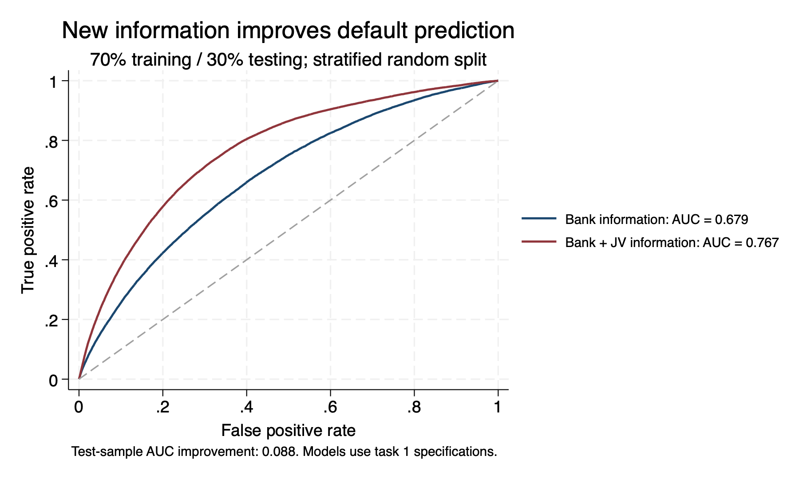
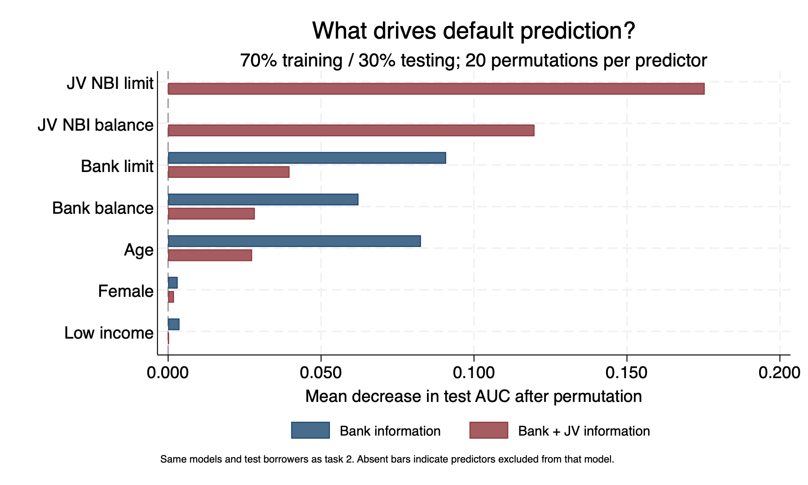
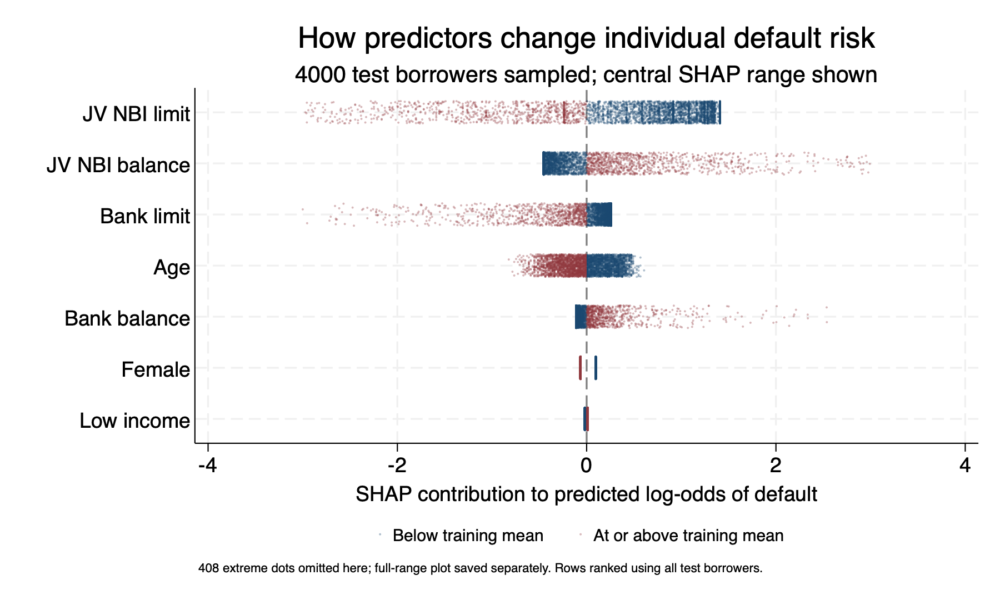

# Credit Default Prediction

Stata analysis of whether JV nonbank issuer (NBI) credit information improves default prediction beyond demographics and bank credit information. The project adapts slides 26–28 of *Information Sharing Regimes and Access to Credit* and adds SHAP explanations.

## Project status

| Task | Status | Main result |
|---|---|---|
| Revised three-column logit table | Complete | Adding credit information improves fit and reduces the remaining low-income association. |
| ROC curves and AUC with a 70/30 split | Complete | Test AUC increases from 0.679 to 0.767 with JV information. |
| Permutation importance | Complete; age check passed | JV limits and balances have the largest importance in the expanded model. |
| SHAP summary plot | Complete; prediction reconstruction checked | Higher JV limits lower model risk contributions; higher JV balances raise them. |
| Additional evaluation metrics | Proposed | Average precision, probability quality, calibration, ablation, and uncertainty analysis remain to be implemented. |

## Requirements

- StataMP 18.
- VS Code is optional. The project was developed with Stata Workbench and Stata All in One.
- The supplied `pre_sample.dta` in `data/raw/`.

The analysis scripts use built-in Stata and Mata functionality. No Python integration or third-party Stata packages are required.

## Folder structure

```text
credit-default/
├── README.md
├── code/
│   ├── 00_config.do
│   ├── 01_prepare_data.do
│   ├── 02_logit_table.do
│   ├── 03_roc_auc.do
│   ├── 04_permutation_importance.do
│   ├── 04_validate_age_importance.do
│   └── 05_shap.do
├── data/
│   ├── raw/                  # Original data; unchanged
│   └── derived/              # Prepared sample, split, predictions, SHAP values
├── reference/                # Original slides and supplied code
├── models/                   # Saved fitted models (.ster)
├── outputs/
│   ├── tables/
│   ├── figures/
│   └── metrics/
└── logs/                     # Preparation, estimation, and validation records
```

Generated folders and files are created by the scripts. An earlier `02_format_table.do` may also be present; it is no longer needed because formatting is included in `02_logit_table.do`.

## Running the analysis

Enter these commands in **Stata's Command window**, not the macOS terminal. Replace the project path if your checkout is elsewhere.

```stata
cd "/Users/nate/PROJECTS/RESEARCH/credit-default"
do "code/02_logit_table.do"
do "code/03_roc_auc.do"
do "code/04_permutation_importance.do"
do "code/04_validate_age_importance.do"
do "code/05_shap.do"
```

Run each script as a whole file. In VS Code, use your configured Stata extension to execute the complete do-file after setting Stata's working directory.

- `02` calls `01`, which calls `00`, to prepare the sample and estimate the table.
- `03` loads configuration and runs preparation only if the prepared sample is absent.
- `04` and `05` require the models and test data saved by `03`.
- The age validation script requires the repetition results saved by `04`.
- Reruns replace generated outputs. The original dataset is not modified.

To run a script from another working directory, provide its full path and pass the project root as its first argument. For example:

```stata
do "/Users/nate/PROJECTS/RESEARCH/credit-default/code/03_roc_auc.do" "/Users/nate/PROJECTS/RESEARCH/credit-default"
```

If preparation changes the analysis sample, existing split assignments must be reviewed before rerunning later tasks. The scripts stop when assignments do not match the sample.

## Data and model specifications

Each observation represents a borrower. December 2014 predictors are used to predict any 90+ default during January–May 2015 (`def90_target`).

| Predictor | Dataset variable | Interpretation |
|---|---|---|
| Age | `age2014` | Decades; 4.9 corresponds to about 49 years |
| Female | `female` | 1 = female; 0 = male |
| Low income | `low_income` | 1 = income bracket 1; 0 = brackets 2–8 |
| Bank limit | `bk_limit_2014m12` | Millions of CLP |
| Bank balance | `bk_balance_2014m12` | Millions of CLP |
| JV NBI limit | `cenco_limit_2014m12` | Millions of CLP |
| JV NBI balance | `cenco_balance_2014m12` | Millions of CLP |

The supplied data are already scaled. Do not rescale age or credit amounts again. Unknown income and gender codes (`9999`) are excluded. All models use a common complete-case sample.

- Original sample: **1,901,685 borrowers**.
- Prepared sample: **1,744,787 borrowers**.
- Prepared-sample default rate: approximately **6.13%**.

The three task 1 specifications are:

1. Age, female, and low income.
2. Model 1 plus bank limit and balance.
3. Model 2 plus JV NBI limit and balance.

Geographic controls and maxed-out exposure are excluded from these revised specifications.

## Methods and findings

### Task 1: Logit table

The table uses the full prepared sample. It reports average marginal effects in percentage points, conventional delta-method standard errors, default mean, observations, and McFadden pseudo R-squared. Binary effects compare 1 with 0.

The low-income effect declines from 2.45 to 0.86 to 0.14 percentage points across the three models. Pseudo R-squared increases from 0.022 to 0.041 to 0.090. Larger limits are associated with lower predicted default risk and larger balances with higher risk, holding other predictors fixed.

Continuous marginal effects are local slopes, not fixed probability changes for large increases in a predictor. These associations are not causal effects.

### Task 2: Held-out ROC/AUC

The split assigns approximately 70% of each outcome class to training and 30% to testing, using seed `20261011` and sorted borrower IDs. Assignments are saved and reused.

- Training: **1,221,350 borrowers**.
- Testing: **523,437 borrowers**.
- Bank-information test AUC: **0.678690**.
- Bank + JV test AUC: **0.766925**.
- AUC improvement: **0.088235**.

Models are fitted only on training borrowers. AUC uses all test observations and gives half credit to ties; displayed curves use approximately 2,000 points each. AUC measures ranking, not classification accuracy. No AUC confidence intervals have yet been estimated.



### Task 3: Permutation importance

Each predictor is shuffled across test borrowers 20 times using seed `20261012`. Native Stata `predict, mu` recalculates probabilities with the fitted model unchanged. Importance is baseline AUC minus shuffled AUC, averaged over repetitions.

In the expanded model, mean AUC drops are approximately 0.1754 for JV limits and 0.1198 for JV balances. Age importance is approximately 0.0827 in the bank-only model and 0.0274 in the expanded model.

The validation script checks the first age permutation in each model using native predictions and an independent average-rank AUC calculation. Both checks passed. Use the updated native-prediction version of `04`; earlier algebraic versions produced small rounding differences around tied scores.

Permutation importance measures model reliance. Correlated predictors complicate attribution, drops are not additive, and shuffle standard deviations are not confidence intervals.



### Task 4: SHAP

The expanded model is explained using exact interventional SHAP on its additive log-odds scale:

```text
SHAP_j = coefficient_j × (borrower value_j − training mean_j)
```

The reference plus the contributions reconstructs every test model score and probability. Global rankings use all test borrowers. Plots show 4,000 sampled borrowers with vertical jitter; colors distinguish values below versus at/above the training mean.

JV limits and balances have the largest mean absolute contributions. The central plot shows contributions between −3 and 3; a separate full-range plot retains extreme sampled dots. No observations are excluded from global calculations.

SHAP values are not probability percentage points, causal effects, or correlation-dependent attributions. Their ranking can differ from permutation importance because they explain predictions rather than changes in AUC.



[Full-range SHAP plot](outputs/figures/task4_shap_full.png)

Method: [SHAP LinearExplainer documentation](https://shap.readthedocs.io/en/latest/generated/shap.LinearExplainer.html).

## Main outputs

| Location | Contents |
|---|---|
| `outputs/tables/task1_table.xlsx` | Readable regression table |
| `outputs/tables/task1_marginal_effects.csv` | Numeric effects and model statistics |
| `outputs/metrics/task2_auc.csv` | Test AUC comparison |
| `outputs/metrics/task3_permutation_summary.csv` | Mean AUC drops and shuffle standard deviations |
| `outputs/metrics/task3_permutation_repetitions.dta` | All 240 permutation results |
| `outputs/metrics/task3_age_validation.csv` | Independent age checks |
| `outputs/metrics/task4_shap_summary.csv` | SHAP reference means, coefficients, and importance ranking |
| `data/derived/task4_shap_values.dta` | Borrower-level SHAP contributions |
| `outputs/figures/` | PNG and editable Stata GPH plots |
| `models/` | Task 1 full-sample and task 2 training-fitted models |
| `logs/` | Execution and validation records |

## Proposed next steps

A future `06_performance_metrics.do` would evaluate:

- **Average precision:** default detection when defaults are uncommon.
- **Log loss and Brier score:** quality of predicted probabilities.
- **Calibration:** agreement between predicted risk and observed default rates.
- **Recall at fixed false-positive rates and high-risk-group lift:** practical screening performance.
- **JV-variable ablation:** incremental value of limits alone, balances alone, and both after refitting.
- **Grouped permutation:** joint reliance on related limits and balances.
- **Subgroup evaluation:** variation across age, gender, income, and bank exposure.
- **Paired bootstrap intervals:** uncertainty around test-performance differences.

These evaluations are proposed, not completed. Additional models must use the existing training sample; evaluation must use the same test borrowers. Operational thresholds should be selected using training-side validation rather than optimized on the test sample.

## Interpretation and data management

The results support the value of JV credit information in this borrower sample. They are not an exact replication of the slides: predictors, missing-value treatment, and evaluation procedures differ. The slide's near-zero age importance remains unresolved without its original importance code. The random split does not test performance in a later period or establish that information sharing causes changes in default or lending.

Keep original data unchanged and out of ordinary Git history. A root `.gitignore` entry of `data/` excludes raw and derived datasets from future tracking; it does not remove data already committed. The raw file exceeds GitHub's ordinary 100 MB file limit. Saved models and generated outputs can also be excluded if the repository is intended to contain only code and documentation.
