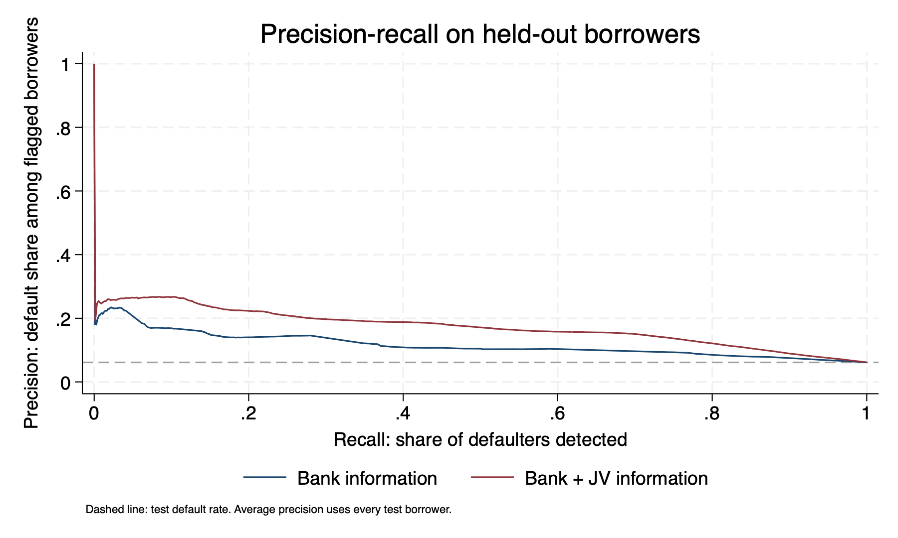
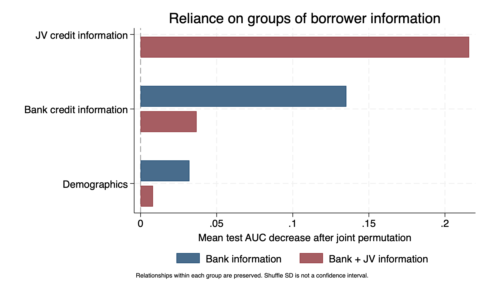
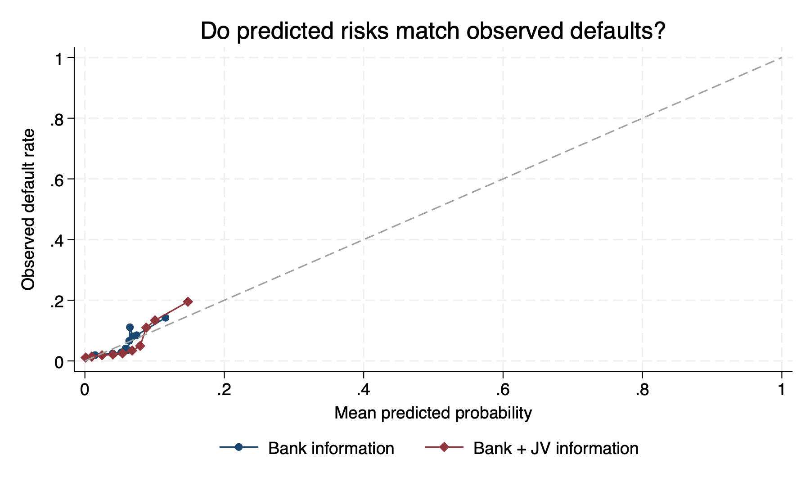

# Credit Default Prediction

This project studies whether JV NBI credit information improves default prediction beyond bank information. It reproduces the requested regression table, ROC curves, permutation importance and SHAP analysis, then evaluates performance using additional metrics.

The current specification replaces continuous age with **Young**. The original age-based analysis is retained in the main project folders; the updated analysis and findings are under `young/`.

## Data and definitions

The input is `data/raw/pre_sample.dta`. December 2014 borrower and credit information is used to predict `def90_target`, indicating any 90-day-or-more default during January–May 2015.

| Variable | Definition |
|---|---|
| `young` | One if age is strictly below the 10th percentile of the training-sample age distribution; zero otherwise. |
| `female` | Female indicator. |
| `low_income` | One for income bracket 1; zero for brackets 2–8. |
| `bk_limit_2014m12` | Bank credit limit in December 2014. |
| `bk_balance_2014m12` | Bank outstanding credit balance in December 2014. |
| `cenco_limit_2014m12` | JV NBI credit limit in December 2014. |
| `cenco_balance_2014m12` | JV NBI outstanding credit balance in December 2014. |

JV means joint venture; NBI means non-bank institution. These variables represent credit information from the institution involved in the JV, rather than a separate credit score.

In the supplied prepared input, credit amounts are already in millions of Chilean pesos and `age2014` is already measured in decades. Do not rescale them again.

The analysis excludes missing required inputs and income/gender values coded `9999`. The complete analysis sample contains 1,744,787 borrowers. The outcome-stratified 70/30 split assigns 1,221,350 borrowers to training and 523,437 to testing, using seed `20261011`.

The training age cutoff is 31 years. Because Young uses a strict inequality and ages are tied, it identifies borrowers under 31 and covers approximately 8.28% of the complete sample, rather than exactly 10%.

## Folder structure

```text
credit-default/
├── README.md
├── .gitignore
├── code/                      # Original age-based scripts
├── data/
│   ├── raw/pre_sample.dta     # Original input
│   └── derived/               # Original analysis data
├── models/                    # Original saved estimates
├── outputs/                   # Original tables, figures and metrics
├── logs/                      # Original execution logs
├── reference/                 # Slide deck and supplied reference code
└── young/
    ├── code/                  # Young specification: tasks 1–4
    ├── proposal/              # Additional evaluation scripts
    ├── data/derived/          # Prepared sample, split and predictions
    ├── models/                # Saved Young, screening and ablation models
    ├── logs/                  # One text log per analysis stage
    └── outputs/
        ├── tables/
        ├── figures/
        │   └── proposal/
        └── metrics/
            └── proposal/
```

Derived datasets are generated by the scripts. Logs record commands, model output and validation checks. `.ster` files retain fitted model estimates; PNG files are for reports, and `.gph` files retain editable Stata graphs.

## Tasks and scripts

| Script | Purpose |
|---|---|
| `young/code/00_config.do` | Defines project paths and creates output folders. |
| `young/code/01_prepare_data.do` | Prepares the complete sample, reuses or creates the split, and defines Young using training ages. |
| `young/code/02_logit_table.do` | Produces the revised three-column regression table. Calls preparation automatically. |
| `young/code/03_roc_auc.do` | Fits bank and bank + JV models on training borrowers and evaluates ROC/AUC on test borrowers. |
| `young/code/04_permutation_importance.do` | Shuffles individual test predictors and measures the decrease in AUC without refitting. |
| `young/code/05_shap.do` | Calculates exact interventional SHAP contributions for the additive logistic score and produces plots. Contributions are in log-odds, not probability percentage points. |
| `young/code/run_all.do` | Runs tasks 1–4 in order. |
| `young/proposal/06_helpers.do` | Shared calculations and input checks; loaded automatically. |
| `young/proposal/06a_performance_calibration.do` | Additional performance metrics, precision–recall curve and calibration diagnostics. |
| `young/proposal/06b_screening_validation.do` | Selects thresholds on internal validation data and evaluates screening on test borrowers. |
| `young/proposal/06c_jv_ablation.do` | Compares bank alone, bank + JV limit, bank + JV balance and bank + both. |
| `young/proposal/06d_grouped_permutation.do` | Jointly shuffles demographic, bank and JV information groups. |
| `young/proposal/06e_subgroups.do` | Compares performance by age, Young status, gender, income and bank exposure. |
| `young/proposal/06f_paired_bootstrap.do` | Calculates confidence intervals for paired test-sample performance differences. |
| `young/proposal/06_run_proposal.do` | Runs all proposal analyses in order. |

The regression table uses these columns, with variables listed in this order:

1. Young, female and low income.
2. Column 1 plus bank limit and bank balance.
3. Column 2 plus JV NBI limit and JV NBI balance.

## Running the project

Use StataMP 18. VS Code can be used to edit the do-files with Stata Workbench or Stata All in One. Run the following commands in Stata, not the macOS shell.

Run the Young tasks:

```stata
cd "/Users/nate/PROJECTS/RESEARCH/credit-default"
do "young/code/run_all.do"
```

Once the Young models, split and test predictions exist, run the proposal:

```stata
do "young/proposal/06_run_proposal.do"
```

The proposal wrapper defaults to 200 bootstrap repetitions and 20 permutations per information group. For a complete proposal run with 1,000 bootstrap repetitions:

```stata
do "young/proposal/06_run_proposal.do" "/Users/nate/PROJECTS/RESEARCH/credit-default" 1000 20
```

To rerun only the bootstrap:

```stata
do "young/proposal/06f_paired_bootstrap.do" "/Users/nate/PROJECTS/RESEARCH/credit-default/young" 1000
```

Individual proposal scripts take the `young/` project path; the wrapper takes the parent `credit-default/` path. Reruns replace the corresponding output files and logs. The reported confidence intervals below use the completed 1,000-repetition bootstrap.

The corrected proposal scripts check `e(rc)==0` after `glm, irls`. They do not use `e(converged)` for IRLS estimation. If a validation check fails, inspect the first failing command and its log before changing the check.

## Findings: Young specification

Both main prediction models are evaluated on the same 523,437 test borrowers, with a default rate of 6.13%.

| Measure | Bank information | Bank + JV information |
|---|---:|---:|
| AUC | 0.6744 | 0.7691 |
| Average precision | 0.1146 | 0.1720 |
| Log loss | 0.2233 | 0.2110 |
| Brier score | 0.05665 | 0.05475 |
| Precision among highest-risk 5% | 16.11% | 22.48% |
| Precision among highest-risk 10% | 14.24% | 19.51% |

Higher AUC, average precision and screening precision are better. Lower log loss and Brier score are better. Average precision improves by approximately 50%; log loss falls by 5.5% and Brier score by 3.4%.

### Contribution of JV information

| Model | Test AUC |
|---|---:|
| Bank information | 0.6744 |
| Bank + JV limit | 0.6885 |
| Bank + JV balance | 0.6808 |
| Bank + both JV variables | 0.7691 |

JV limit and balance produce a much larger gain together than either produces alone. This suggests complementary predictive information; it does not establish a causal effect or an explicit interaction in the fitted model.

Jointly shuffling JV limit and balance reduces the expanded model’s AUC by approximately 0.216. Its corresponding decreases for bank information and demographics are 0.037 and 0.008. Permutation importance measures reliance on inputs; these values do not add up to the original model improvement.

### Screening and subgroup results

At validation-selected thresholds targeting a 5% false-positive rate, the bank model detects 14.21% of defaulters and the expanded model detects 21.54%. Actual test false-positive rates are 4.98% and 4.94%.

These supplementary screening models use an 80/20 split of the original training portion: roughly 56% of all borrowers for estimation, 14% for threshold selection and the original 30% for testing. Their results should be distinguished from the main models fitted on the entire 70% training portion.

AUC improves in every reported subgroup. The largest gain is among borrowers with no recorded bank limit or balance, from 0.555 to 0.759. Subgroup comparisons are exploratory and do not include subgroup confidence intervals.

### Calibration

The expanded model’s joint calibration intercept is 0.0102 and slope is 1.0044, close to the ideal values of zero and one. However, the calibration bins reveal meaningful differences between predicted and observed risks.

For its highest-risk tenth, mean predicted default is 14.78%, compared with an observed default rate of 19.51%. Several middle-risk bins show overprediction. Better overall probability performance should not be interpreted as perfect calibration.

### Bootstrap uncertainty

The paired borrower bootstrap uses 1,000 repetitions. All ten reported improvements have 95% percentile confidence intervals excluding zero. The AUC improvement is 0.0947, with an interval of 0.0922–0.0970.

These intervals reflect test-borrower sampling uncertainty conditional on fitted models. They do not include uncertainty from refitting, selecting thresholds or transferring the model to another period or population.

## Main proposal outputs

Summary files are in `young/outputs/metrics/proposal/`:

- `performance_comparison.csv`: main model performance and changes.
- `calibration_parameters.csv` and `calibration_bins.csv`: overall and grouped calibration diagnostics.
- `screening_test_results.csv` and `screening_validation_thresholds.csv`: validation-selected screening results and cutoffs.
- `jv_ablation_comparison.csv`: contribution of each JV variable and both together.
- `grouped_permutation_summary.csv`: average deterioration after joint shuffling.
- `subgroup_comparison.csv`: within-group model comparisons.
- `bootstrap_confidence_intervals.csv`: final uncertainty estimates.

Graphs are in `young/outputs/figures/proposal/`:







For reporting, focus both calibration axes on approximately 0–25% so differences are visible. Regenerating the calibration stage restores its original 0–100% plot unless the plotting command in 06a is also updated.

## Interpretation and reproducibility

- These results establish predictive value within the held-out sample, rather than causal effects on repayment or measured lending profitability.
- Average precision uses distinct prediction thresholds with ties grouped. It is not trapezoidal area under the precision–recall curve.
- Top-5%/10% precision uses expected random selection within a tied cutoff group to maintain screening capacity.
- Test-curve recall at fixed false-positive rates is descriptive. Operational thresholds are selected separately using validation borrowers.
- Grouped permutation preserves relationships within each shuffled group but disrupts relationships with other groups. Shuffle standard deviations are not confidence intervals.
- SHAP contributions explain the fitted model’s log-odds predictions and depend on the training reference distribution.
- The analysis uses a random borrower split, not validation on a later period.
- Raw data should be retained locally and excluded from Git. The input exceeds GitHub’s ordinary file-size limit. Adding `data/` to `.gitignore` does not remove data already committed to history. Also exclude generated borrower-level data under `young/data/` where appropriate.
- Keep source scripts, data definitions, seeds and logs together so the findings can be reproduced.